<p align="center">
  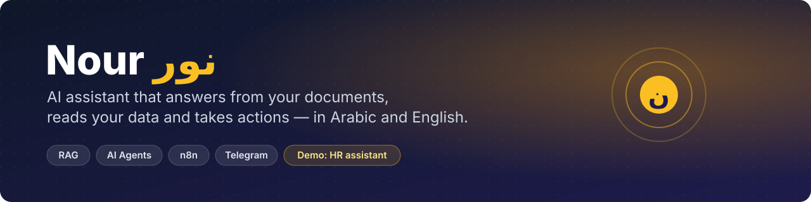
</p>

<p align="center">
  
  
  
  
  
  
</p>

<p align="center">
  <a href="#demo-hr-assistant-for-nexora">Demo</a> ·
  <a href="#architecture">Architecture</a> ·
  <a href="#the-workflows">Workflows</a> ·
  <a href="#engineering-decisions-with-the-evidence">Decisions</a> ·
  <a href="#evaluation">Evaluation</a> ·
  <a href="#work-with-me">Contact</a>
</p>

> **نور** — مساعد ذكي بالعربي والإنجليزي: بيجاوب من مستندات الشركة بالمصادر، بيقرا بيانات المستخدم، وبينفّذ طلبات بعد تأكيد.

Nour is an AI assistant you can plug into any organization:

| | |
|---|---|
| 📚 **Knowledge (RAG)** | Answers from your documents with the exact source of every fact, and understands follow-up questions. |
| 🗂️ **Data** | Reads the user's own records from your database (balances, requests, history). |
| ✅ **Actions** | Prepares requests, asks for confirmation, then writes them to your system. |
| 💬 **Conversation** | Remembers the recent chat, replies in the user's language, never stays silent (every model call has an error path). |

Nour started as an internal HR assistant built for a company. This repo shows the full system on a fictional company,
**Nexora Digital Solutions (نيكسورا)**, with a made-up HR policy and mock employee data — the same design fits customer support,
internal help desks, sales and onboarding.

> **Live demo available on request** — [email me](#work-with-me) and I'll run it for you.

## Demo: HR assistant for Nexora

| Employee says | Nour does |
|---|---|
| «إجازة الجواز كام يوم؟» | Searches the policy and answers with the exact rule and its conditions, then lists the clauses used (`📌 المصادر: البند 2-4-5`) |
| «طب ولو لسه مكملتش 6 شهور؟» | Understands the follow-up refers to marriage leave and answers for that case |
| «رصيد إجازاتي كام؟» | Reads the employee's own balance: 21 annual, 7 casual, nothing pending |
| «عايز أقدم إجازة سنوية يوم الأحد الجاي» → «أيوه أكد» | Prepares the request, **asks for confirmation**, then submits it and names the approving manager |
| «نسيت الباسورد أعمل إيه؟» | FAQ answer (procedures and tools) |
| «زميلي بيقاطعني في الاجتماعات» | Practical work advice in warm Egyptian Arabic |
| «شكراً» / «أهلاً» | Fixed reply in code — no model call |
| English questions | Answers fully in English (language decided in code) |

### Screenshots (real Telegram chats with the demo bot)

<table>
<tr>
<td align="center" valign="top" width="33%">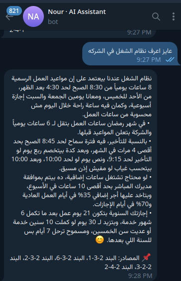<br><sub><b>Policy answer with sources</b><br>working hours, lateness, overtime, annual leave</sub></td>
<td align="center" valign="top" width="33%">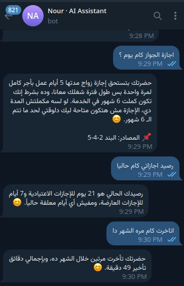<br><sub><b>Follow-up + own data</b><br>marriage leave, leave balance, lateness this month</sub></td>
<td align="center" valign="top" width="33%">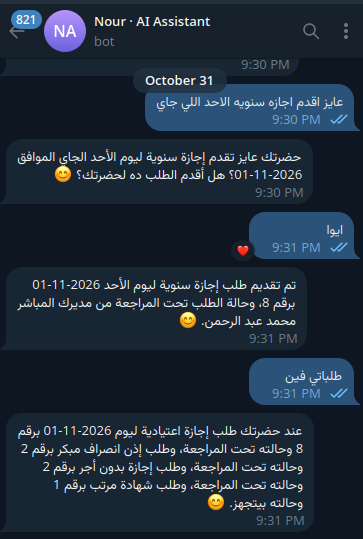<br><sub><b>Leave request with confirmation</b><br>prepared → confirmed → submitted, then "my requests"</sub></td>
</tr>
<tr>
<td align="center" valign="top">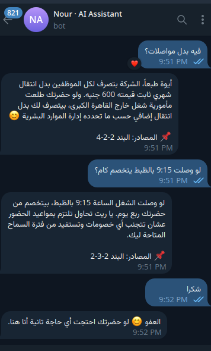<br><sub><b>Exact rules</b><br>transport allowance, arriving at 9:15 exactly, thanks answered in code</sub></td>
<td align="center" valign="top">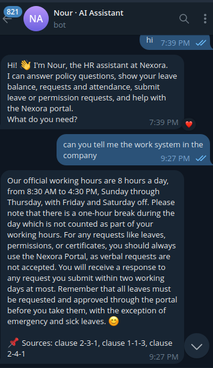<br><sub><b>English</b><br>welcome message and a full English answer with sources</sub></td>
<td align="center" valign="top">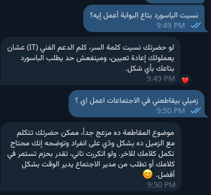<br><sub><b>FAQ + work advice</b><br>forgotten password, a colleague who interrupts</sub></td>
</tr>
</table>

## Architecture

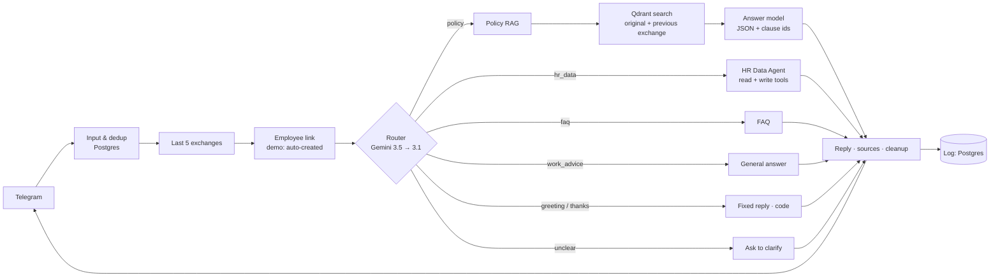

## The workflows

Seven n8n workflows: one main flow that calls six sub-workflows. Every diagram below is generated from the exported JSON in [`workflows/`](workflows/) — click any image to open it full size.

### Chat Bot (main)

Telegram in/out, dedup, history, employee link, routing, reply cleanup, logging. Every sub-workflow call has an **error branch** (red), so the employee always gets a reply.

<a href="docs/workflows/chat-bot.svg"></a>

<table>
<tr>
<td width="50%" valign="top">
<b>Router</b> — one model call with the last 3 exchanges → policy / hr_data / faq / work_advice / unclear. Fixed replies skip the model; Gemini 3.5 falls back to 3.1.<br><br>
<a href="docs/workflows/router.svg"></a>
</td>
<td width="50%" valign="top">
<b>Policy RAG</b> — two searches (original + previous exchange), 5 chunks, grounded JSON answer with a fallback model, sources added by code.<br><br>
<a href="docs/workflows/policy-rag.svg"></a>
</td>
</tr>
<tr>
<td width="50%" valign="top">
<b>HR Data Agent</b> — an AI agent with 10 database tools: balance, requests, attendance, memos, submit / cancel (confirm before every write).<br><br>
<a href="docs/workflows/hr-data-agent.svg"></a>
</td>
<td width="50%" valign="top">
<b>FAQ</b> — vector search over procedures and tools questions; a model answers only when there is no FAQ hit.<br><br>
<a href="docs/workflows/faq.svg"></a>
</td>
</tr>
<tr>
<td width="50%" valign="top">
<b>General</b> — work advice and casual talk.<br><br>
<a href="docs/workflows/general.svg"></a>
</td>
<td width="50%" valign="top">
<b>Onboarding</b> — links a Telegram user to an employee account (auto-created for demo visitors).<br><br>
<a href="docs/workflows/onboarding.svg"></a>
</td>
</tr>
</table>

## Models and fallbacks (all free tier)

| Part | Main | Fallback | Why |
|---|---|---|---|
| Router | gemini-3.5-flash-lite (8 s timeout) | gemini-3.1-flash-lite | [40/42 on the router test set](docs/evaluation.md#1-router-42-conversation-cases) |
| Policy answer | gemini-3.1-flash-lite (7 s timeout) | gemini-3.5-flash-lite | [8/8 correct + best tone in the free-models test](docs/evaluation.md#4-free-gemini--gemma-models-8-hard-questions) |
| General answer | gemini-3.5-flash-lite | — | fast; no policy numbers involved |
| HR data agent | gemini-3.5-flash-lite | — | tool calling; every write needs a confirmation |

Every model call has an error path: a fallback model for the router and policy answers, and a polite apology if everything fails — never silence.

## Engineering decisions (with the evidence)

The full reasoning and numbers are in [`docs/decisions.md`](docs/decisions.md).

1. **One router call with the last 3 exchanges** (replaced a two-call design). Short follow-ups take the route of the *last* exchange; «تمام / أيوه» confirm a pending request instead of being treated as small talk.
2. **[No LLM query rewrite.](docs/decisions.md#1-follow-up-questions-no-llm-query-rewrite)** On the free tier it was late 5 of 6 times; a second search built in code (previous question + start of the previous answer + current message) found the right clauses 5/5, is faster, and can never change the employee's question.
3. **The best 3 chunks of the original search are always kept**, so the follow-up search can only *add* context.
4. **One chunk per policy clause** with clause ids in metadata; sources are added by code, never typed by the model.
5. **Grounding rules**: no number or penalty that is not written in a clause; ranges applied exactly ("from X to Y" includes Y); say clearly when a condition is not met yet.
6. **Reply language decided in code**; **forbidden words removed in code** (e.g. «يا فندم», «سيادتك») for every route in one place — prompts alone were not reliable.
7. **Write actions need an explicit confirmation**, and the database user of the bot has only the permissions it needs.
8. **[Models chosen by tests, not marketing](docs/evaluation.md)**: 8 free models, a local 35B model (vLLM) and a paid model compared on the same chunks and prompt.

## Evaluation

### Final system

| Test | Result |
|---|---|
| Router — 42 cases (follow-ups, topic changes, English, prompt injection) | ✅ 40/42 correct (2 lost to network errors, 0 wrong decisions) |
| Policy answers — 30 questions (gemini-3.5-flash-lite) | ✅ 28 correct, 2 partial, **0 wrong facts** |
| Re-test of the hard cases after the prompt fixes (boundaries, English, follow-ups, third person) | ✅ 9/9 correct |
| Policy answer model — 8 hard questions (gemini-3.1-flash-lite, final main model) | ✅ 8/8 correct |
| [End-to-end demo test](docs/evaluation.md#6-end-to-end-demo-test-nexora-demo-bot-2026-10-30) (policy, follow-up, balance, leave request + confirm, FAQ, advice, new visitor) | ✅ all routes correct, all features working |
| [Response time](docs/evaluation.md#7-response-time-live-bot-2026-10-28) (Telegram message → reply) | ✅ 0.4 s fixed replies · 1–5 s typical (measured) · ≈11 s worst case when a fallback answers (calculated) |

### Model selection (same chunks, same prompt, free tier, Oct 2026)

| Model | Policy answers | Router | Decision |
|---|---|---|---|
| gemini-3.1-flash-lite | 8/8 (hard set) | — | **Policy answers (main) + router fallback** |
| gemini-3.5-flash-lite | 28/30 correct, 0 wrong facts | 23/23 of the cases it decided (42-case set) | **Router (main) + policy fallback** |
| Qwen3.7 Flash (paid, OpenRouter) | 21/30 correct, 7 partial, 2 wrong facts | 32/33, 1.3 s | Not used: wrong facts, invented details |
| Qwen3.6-35B-A3B (local, vLLM) | 23/30 correct, 3 wrong / no answer, 7.6 s median | 31/33, 0.5 s | Fast enough for routing; not accurate enough for policy |
| gemini-2.5-flash | 6/8 correct, 2 partial (hard set), 8.4 s median | — | Not used: slow, 20 requests/day |
| Gemini 3 / 3.6 / 3.7 Flash | correct when they answered | — | Not used: 20 requests/day, often busy |
| Gemma 4 26B / 31B | mostly unavailable or errors | — | Not used: unreliable on the free tier |

Questions, results and the decision each test led to: [`docs/evaluation.md`](docs/evaluation.md).

## Repository layout

<details>
<summary>Show folders</summary>

```
data/              nexora_hr_policy.md — the fictional policy (39 clauses)
prompts/           router.md, policy_answer.md, general.md
workflows/         n8n workflow exports (no credentials, no ids) — see workflows/README.md
scripts/           export_workflows.sh — export workflows from n8n and remove private fields
                   clean_workflow.mjs — clean names and wording of each export
                   render_workflows.mjs — draw docs/workflows/*.svg from the exports
docs/decisions.md  engineering decisions with the numbers behind them
docs/workflows/    workflow diagrams (generated)
docs/screenshots/  Telegram screenshots of the demo bot
docs/evaluation.md every test: questions, results, decisions
```
</details>

## Use it for other domains

Swap three things and Nour becomes a different assistant: the documents indexed in Qdrant (policies → product docs, contracts, FAQs), the database tools (HR records → orders, tickets, CRM), and the route list in the router prompt.

## Roadmap

- Alerts when a message fails
- Voice messages (speech-to-text)

## Work with me

Built by **Ayman Mohamed Abdallah** — AI Engineer.

I build assistants like this one for businesses: answers from your own documents with sources,
AI agents that read and update your systems safely, and the n8n automations around them — tested before they go live.

📧 **[ayman.mohamed141163@gmail.com](mailto:ayman.mohamed141163@gmail.com)** — for a live walkthrough of Nour or to talk about your project.
